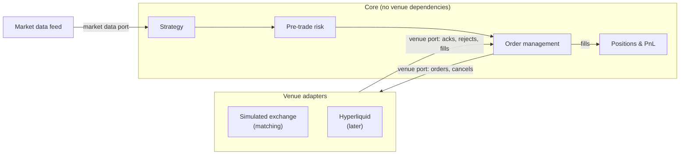

# rust_engine

A trading-side perpetual futures trading and risk engine written in Rust.

This is the client side of trading, not an exchange. The engine turns market data into strategy decisions, checks each order against pre-trade risk limits, manages the order lifecycle, and tracks positions and PnL from fills. Order matching sits outside the core, behind a venue interface.

> **Status:** Unit 1 (core order types) and Unit 2 (order state machine) are complete.

## Architecture

The engine uses a hexagonal (ports and adapters) design. The core holds the trading logic and has no dependency on any venue. Venues plug in as adapters that implement the core's ports.



- **Core:** strategy, pre-trade risk, order management, positions and PnL. It defines the ports and depends on nothing outside itself.
- **Ports:** the interfaces the core owns. The venue port carries orders and cancels out, and acks, rejects and fills back in. The market data port carries prices in.
- **Adapters:** implement the ports for a specific venue: a simulated exchange (with matching) for testing, and Hyperliquid later. Swapping venues means swapping adapters, with no change to the core.

## Design decisions

- **No floating point for prices or quantities.** Prices are integer ticks (`u64`), so rounding errors can't build up in risk or PnL calculations.
- **Signed quantity encodes the side.** Positive means buy and negative means sell, so position arithmetic is plain addition.
- **Construction is validated.** `Order::new` returns a `Result` and rejects zero quantity and zero limit price. Fields are private, so an invalid order can't be built any other way.
- **Exchange ID is set exactly once.** `exchange_id` is `None` until the venue acknowledges the order. `ack(id)` sets it, and a duplicate ack can't overwrite it.
- **The core has no panics.** Errors are returned as `Result`. `unwrap()` appears only in tests.
- **Explicit order lifecycle.** Each order has one status: PendingNew → Acked → PartiallyFilled → Filled, or it ends Rejected or Cancelled. Only a PendingNew order can be acked or rejected by the venue. Filled, Rejected and Cancelled are terminal, and any further fill, cancel, ack or reject on them is rejected.
- **Fills are validated before any state changes.** `take_fill` rejects fills for another order, fills on a closed order, a zero price, a wrong-sign or zero quantity, and overfills. A rejected fill leaves the order exactly as it was.
- **A cancel keeps executed quantity.** Cancelling a partially filled order keeps the filled quantity (`cum_qty`) and drops only the unfilled remainder.

## Project layout

```
src/
├── lib.rs     # library crate root: declares the core modules
├── order.rs   # Order, OrderType, OrderStatus, OrderError, Fill + unit tests
└── main.rs    # thin binary that uses the library
```

## Build and test

```sh
cargo build
cargo test
cargo run
```

## Roadmap

- [x] **Unit 1:** core types (`Order`, `OrderType`, `OrderError`, `Fill`) with validation and unit tests
- [x] **Unit 2:** order state machine (status and filled quantity, fills applied with validation, ack/reject, cancel)
